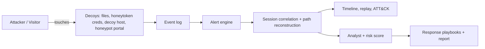

# DeceptionNet - Cyber Deception System

Decoy files, honeytoken credentials and decoy hosts that detect intruders, reconstruct their movement and trigger a response.

## Features
- Simulated 7-host network with decoy files, fake credentials and a decoy host
- **Real honeypot portal** (`/?page=portal`): captures live visitors (IP, browser, actions)
- **Hybrid detection:** deception alerts (certainty) + behavioural anomaly score from a normal-staff baseline model (early warning)
- Alert engine: decoy touch = high-confidence alert (0 false positives for normal users)
- Session correlation, attack path reconstruction, **step-by-step replay**
- MITRE ATT&CK mapping, incident timeline and downloadable report
- Threat analyst: intent, skill level, next-move prediction, **risk score 0-100**
- One-click response playbooks (block IP, isolate host, rotate creds, ticket)
- **Attack-graph coverage analysis:** enumerates every route to the crown jewel, finds blind spots, recommends decoy placement
- **Adaptive baseline:** behavioural model keeps learning from observed benign sessions
- Live honeypot events persisted in SQLite, enriched with IP geolocation; IOC export (JSON)
- Optional Claude / Gemini integration (`ANTHROPIC_API_KEY` or `GEMINI_API_KEY`) for executive summary and analyst chat

## Architecture


## Run
```
pip install -r requirements.txt
streamlit run app.py
```
Open `/?page=portal` on the deployed URL to trigger the live honeypot.

## Tech
Python, Streamlit, Plotly, pandas. AI assistance: Claude (code generation and debugging).
